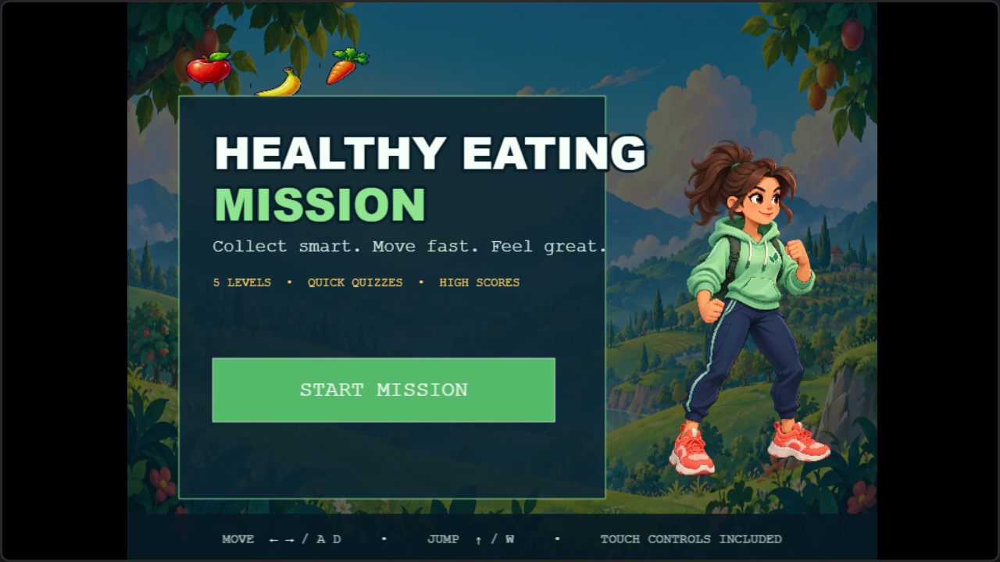
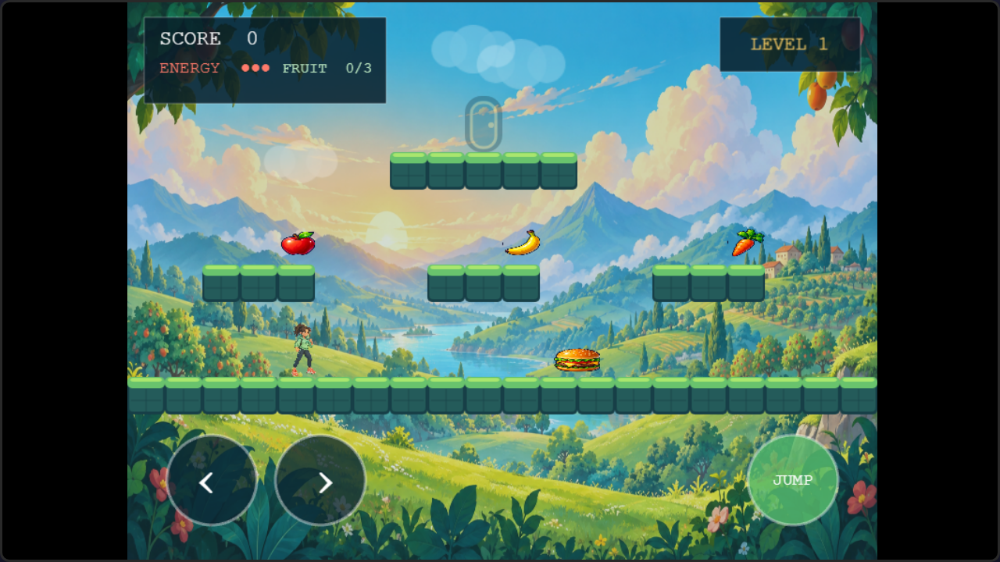
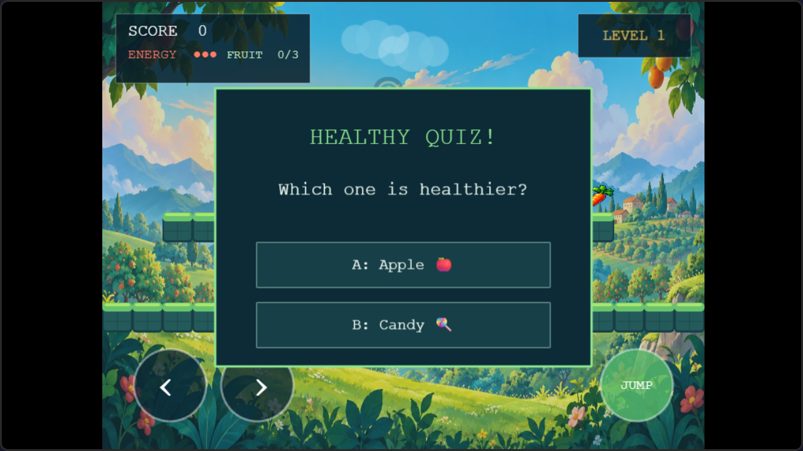
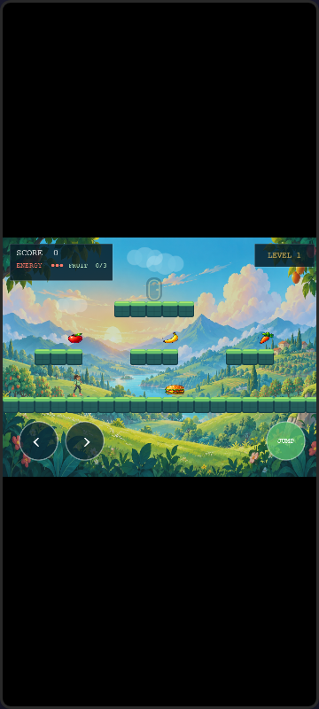

# Healthy Eating Mission

An original five-level HTML5 platform game built with Phaser 3 and prepared for
the YouTube Playables runtime. Race through a bright garden valley, collect
nutritious foods, avoid hazards, answer quick food-knowledge questions, and build
a high-score streak.



## Game overview

Healthy Eating Mission combines short platforming levels with optional learning
moments. Every level has three goals:

1. Move through the level with the keyboard, mouse, or touch controls.
2. Collect every apple, banana, and carrot while avoiding burgers and soda.
3. Reach the glowing garden gate after all healthy foods have been collected.

Collecting foods consecutively increases the **Fresh Streak** multiplier. Quiz
answers can add 50 bonus points, and every answer is followed by a short factual
explanation. Finishing Level 5 displays an explicit completion screen.



## Features

- Five hand-authored platforming levels
- Original illustrated garden environment, player character, and food assets
- Keyboard, mouse, and touch controls
- Responsive 4:3 game canvas with safe pillarboxing or letterboxing
- Healthy-food collection, hazards, energy, scoring, and streak bonuses
- Eight randomized nutrition questions with answer explanations
- Continue/new-mission flow and persistent personal best
- YouTube Playables cloud saves and score submission
- YouTube-controlled pause, resume, and audio state
- Lightweight procedural particles, platforms, clouds, and gate effects
- No advertising, purchases, tracking, personal-data collection, or third-party calls



## Controls

| Action | Keyboard | Mouse / touch |
| --- | --- | --- |
| Move left | Left Arrow or `A` | Left on-screen button |
| Move right | Right Arrow or `D` | Right on-screen button |
| Jump | Up Arrow or `W` | `JUMP` button |
| Close a quiz | `Esc` | Select either answer |

The same running game is preserved when the viewport changes. On very narrow
portrait displays, the complete 4:3 playfield is centered with letterboxing so no
controls or level content are cropped.



## YouTube Playables integration

The integration is isolated in
[`utils/youtubePlayables.js`](utils/youtubePlayables.js). The game currently
implements the following platform behavior:

| Requirement | Implementation |
| --- | --- |
| SDK initialization | YouTube Playables SDK v1 loads before Phaser and game code |
| First visible frame | Calls `ytgame.game.firstFrameReady()` while the loading screen is visible |
| Interactable state | Calls `ytgame.game.gameReady()` after the menu has rendered |
| Cloud save | Awaits `loadData()` before using `saveData()` |
| Backward compatibility | Save input is parsed defensively and normalized to schema version 1 |
| Scores | Sends integer final scores with `ytgame.engagement.sendScore()` |
| Audio | Applies `isAudioEnabled()` and listens to `onAudioEnabledChange()` |
| Pause/resume | Stops the Phaser loop and active scenes using `onPause()`/`onResume()` |
| Responsive layout | Recalculates the canvas after non-zero viewport resizes |
| Offline bundle | Phaser and all art are included locally; only the required YouTube SDK is remote |

Outside YouTube, the integration adapter becomes a safe local-development layer:
save data is stored in `localStorage`, while YouTube-only calls become no-ops.

The save schema is intentionally small:

```json
{
  "version": 1,
  "currentLevel": 0,
  "score": 0,
  "health": 3,
  "bestScore": 0,
  "completed": false
}
```

Official references:

- [YouTube Playables overview](https://developers.google.com/youtube/gaming/playables)
- [SDK reference](https://developers.google.com/youtube/gaming/playables/reference/sdk)
- [Certification requirements](https://developers.google.com/youtube/gaming/playables/certification/requirements)
- [SDK Test Suite guide](https://developers.google.com/youtube/gaming/playables/reference/test_suite_guide)

## Run locally

ES modules must be served over HTTP; opening `index.html` directly with a
`file://` URL is not supported.

From the repository root, run either:

```powershell
npx --yes http-server . -p 4173 -a 127.0.0.1 -c-1
```

or use any equivalent static web server, then visit:

```text
http://127.0.0.1:4173/index.html
```

## Build the upload ZIP

On Windows PowerShell:

```powershell
.\scripts\build-playable.ps1
```

This creates `youtube-playable.zip`. The archive contains `index.html` directly
at its root, along with only the runtime directories required by YouTube:

```text
index.html
main.js
assets/
scenes/
utils/
vendor/
```

README files, repository metadata, screenshots, and development scripts are not
included in the Playables upload.

## Test before certification

1. Run the game locally and complete all five levels using keyboard controls.
2. Repeat the core flow using mouse and touch input.
3. Resize the viewport through portrait, square, landscape, and ultrawide ratios.
4. Verify pause/resume, mute/unmute, cloud save, and score events in the official
   YouTube Playables SDK Test Suite.
5. Upload the ZIP to a draft in the Playables Developer Portal.
6. Test the provided development link on desktop web, mobile web, Android, and iOS.
7. Add accurate metadata, thumbnail images, developer information, and only those
   accessibility tags the released game genuinely supports.
8. Submit the tested release for certification.

Developer Portal access is controlled by YouTube. A channel must be onboarded to
Playables before it can upload and submit a release.

## Project structure

```text
assets/images/             Original game artwork
docs/screenshots/          README and verification screenshots
scenes/BootScene.js        Loading, texture preparation, and startup
scenes/MenuScene.js        Main menu and continue/new-game flow
scenes/GameScene.js        Platforming, level building, scoring, and hazards
scenes/UIScene.js          Score, energy, fruit, streak, and level HUD
scenes/QuizScene.js        Questions, feedback, facts, and Esc handling
scenes/GameOverScene.js    Completion/retry result screen
utils/constants.js         Levels, colors, copy, and question data
utils/helpers.js           Procedurally generated lightweight textures
utils/youtubePlayables.js  YouTube SDK adapter and save-state schema
vendor/phaser.min.js       Locally bundled Phaser 3.60.0 runtime
scripts/build-playable.ps1 Reproducible upload-ZIP builder
index.html                 Playables entry point and loading screen
main.js                    Phaser configuration and system integration
```

## Level format

Levels are stored as 20-column character maps in `utils/constants.js`:

| Character | Meaning |
| --- | --- |
| `.` | Empty space |
| `1` | Platform tile |
| `2` | Player start |
| `3` | Apple |
| `4` | Banana |
| `5` | Carrot |
| `6` | Burger hazard |
| `7` | Soda hazard |
| `8` | Exit gate |

This format makes it possible to design or rebalance levels without changing the
gameplay engine.

## Audience and content

This release is designed for a general audience aged 13 and older. It does not
request names, ages, locations, login details, or any other personal information.
The educational content is general wellness information and is not medical or
dietary advice.

## Art and third-party software

The garden environment, player character, and food atlas were created as original
assets for this project using OpenAI's built-in image generation tooling. The
remaining visual effects are produced procedurally at runtime. No third-party
brands or logos are used.

Phaser 3.60.0 is distributed under the MIT License. Its license text is included
at [`vendor/PHASER_LICENSE.md`](vendor/PHASER_LICENSE.md).

## Repository

GitHub: [Omatsulijoshua/HTML5-GAME-2](https://github.com/Omatsulijoshua/HTML5-GAME-2)
